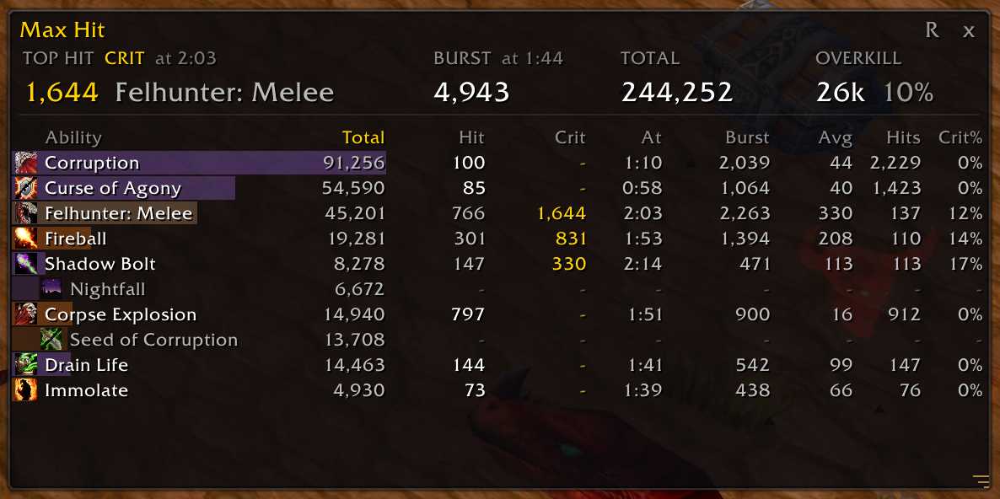
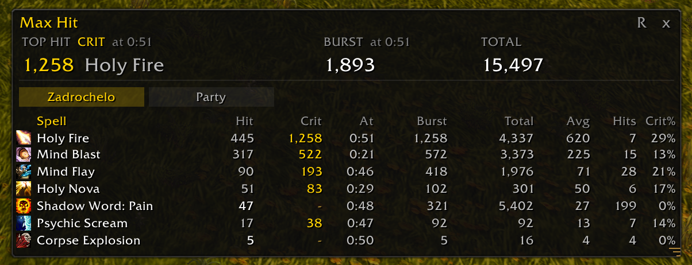
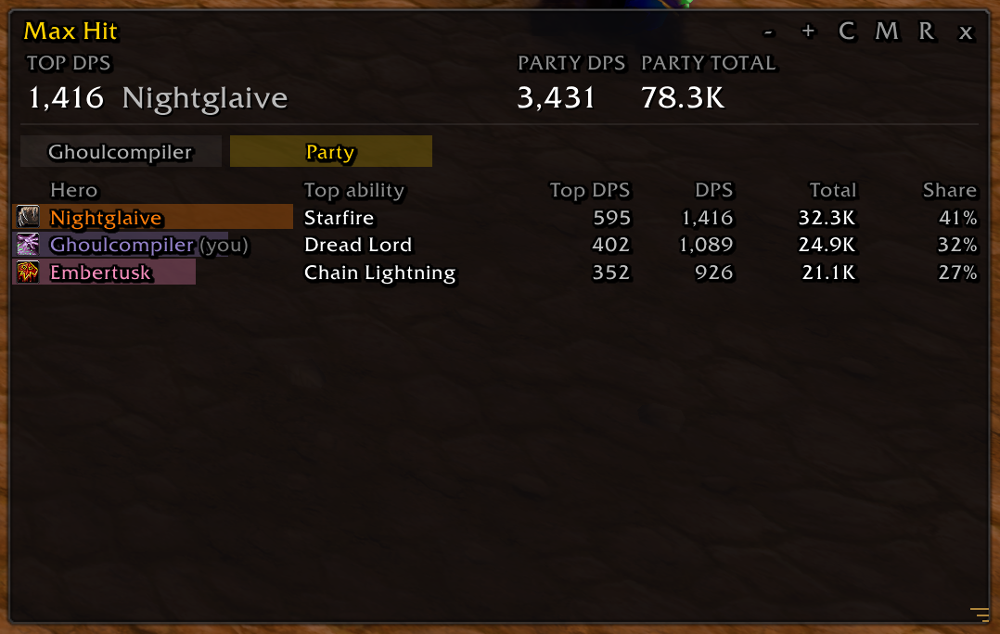
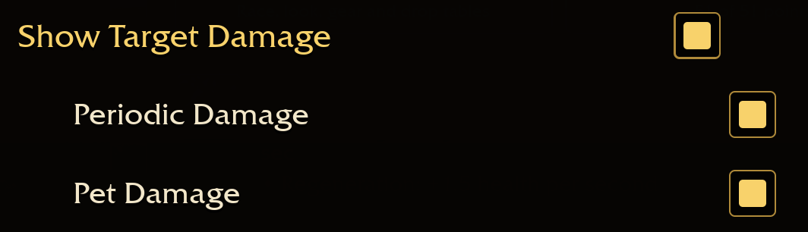

# AZS Max Hit

An addon for [Azeroth Survivors](https://wow.aethus.pl/) that shows each ability's **biggest hit**, **biggest crit**, **burst** and **total damage** for the current run.

Damage meters tell you which ability did the most damage overall. AZS Max Hit tells you how hard each ability actually hits: the single biggest number it put on an enemy, and the most damage it did in one second.

**[Download the latest version](https://github.com/GhoulCompiler/AZSMaxHit/releases/latest)** · [What's new](CHANGELOG.md)

## Features

- **Summary at the top:** your top hit (with the ability, whether it crit, and when), your best burst, your total damage this run, and your overkill: damage past what enemies had left.
- **A row per ability** (spells, melee, pets and procs) with its total, biggest normal hit, biggest crit, run time of its top hit, burst, average hit, hit count and crit rate. Click a column header to sort by it.
- **Pets and summons** get their own rows, e.g. `Water Elemental: Waterbolt`.
- **Procs under their ability:** item and talent procs (Pendant of the Plague, Shadowy Apparitions, Shadowform, ...) appear indented under the ability that triggers them, with their total from the game's meter. The game doesn't report single proc hits, so their other columns show a dim *-*.
- **Party view in co-op:** a Party tab compares every hero side by side: top ability, its DPS, DPS, total and share, straight from the game's party meter. See [Co-op](#co-op).
- **Fill bars** show at a glance which abilities do the most damage, colored by damage school (Shadow, Fire, Frost, ...).
- **Icons** from your spellbook, talents, items and the game's own meter.
- **Fresh every run:** the window clears by itself when a new run starts. Nothing from past runs is kept.
- **Resizable:** drag the grip in the bottom-right corner to set the height; scroll with the mouse wheel.

Pure Lua (`.toc` and `.lua` only): no DLLs or executables. Works in the browser and desktop editions. Tested with game version **0.132.0**.

## Co-op

In co-op, two tabs appear under the summary: one with your name for your own abilities, and **Party** to compare everyone.

| Your tab | Party tab |
|---|---|
|  |  |

*The screenshots use an example party.*

The Party tab shows each hero with their class icon and color, their top ability and its DPS, their DPS, total damage and share of the party's damage.

## Install

Download the `AZSMaxHit-<version>.zip` file from the [latest release](https://github.com/GhoulCompiler/AZSMaxHit/releases/latest).

**Browser:** in game, open **Options → AddOns → Install AddOns** and pick the zip. Make sure AZS Max Hit is switched on; it loads at your next run.

**Windows / Linux:** open **Options → AddOns → Open AddOns Folder** and unzip there, so the path ends in `AddOns/AZSMaxHit/AZSMaxHit.toc`.

> If you use GitHub's green **Code → Download ZIP** instead of the release, the folder is called `AZSMaxHit-main`. The browser edition doesn't mind; on desktop, rename the folder to `AZSMaxHit`.

## Game settings

The addon reads the damage the game reports, so turn these on in **Options → Combat**:

| Setting | Why |
|---|---|
| **Show Target Damage** | Required: with it off, the game reports no damage and the window stays empty |
| **Periodic Damage** | Damage over time (Shadow Word: Pain, Ignite, ...) |
| **Pet Damage** | Pets and summons (Water Elemental, Imp, ...) |

## Commands

| Command | What it does |
|---|---|
| `/maxhit` or `/mh` | Show or hide the window |
| `/maxhit reset` | Clear the numbers now (they also clear by themselves at every new run) |
| `/maxhit lock` | Lock the window's position and size |
| `/maxhit icons` | Icons on or off |
| `/maxhit meter` | List what the game's own meter reports, and abilities still missing an icon |
| `/maxhit party` | List what the game's party meter reports (co-op) |
| `/maxhit top` | Print the game's exact message for each ability's biggest hits |
| `/maxhit help` | List all commands in game |

## Columns

| Column | Meaning |
|---|---|
| **Total** | The ability's own damage this run, from the game's meter: procs and overkill not included. Sorting by Total sorts an ability together with its procs |
| **Hit** | Biggest normal (non-crit) hit |
| **Crit** | Biggest crit. Whichever of Hit and Crit is larger is highlighted |
| **At** | Run time when the ability's top hit landed |
| **Burst** | Most damage the ability did within any one second |
| **Avg** | Average hit |
| **Hits** | Number of hits |
| **Crit%** | Share of hits that crit |

## Good to know

- **Empty window, or DoTs and pets missing?** Check the [game settings](#game-settings).
- The addon reads the combat log, which is in **English**. A game set to another language may need its own patterns; open an issue if that's you.
- **An ability's row includes its procs.** The combat log reports proc hits under the triggering spell's name (Shadowy Apparitions as Mind Blast, Pendant of the Plague ticks as Shadow Word: Pain), so an ability's Hit, Crit, Burst and Hits include them. Total doesn't: it comes from the game's meter, which keeps procs apart, and the indented rows show each proc's own total. Procs the addon can't place under an ability, like Shadow Weaving, get a grayed row of their own. The talent-to-spell list covers all nine classes and comes from the talent tooltips; if a proc that casts one spell still shows on its own row, please [open an issue](https://github.com/GhoulCompiler/AZSMaxHit/issues) with the output of `/maxhit meter`.
- **Damage-over-time spells** (Shadow Word: Pain, Devouring Plague, Serpent Sting, Rend, ...) show only their own ticks. Other hits the game logs under their name, like Shadow Weaving strikes or Pendant of the Plague's explosion, are matched to the right proc row by watching which proc's total in the game's meter went up, so those procs get real Hit and Crit numbers. Hits that can't be matched show as **Other hits** under the spell. Spells that hit directly anyway, like Mind Blast, can't be split this way.
- **Overkill** is the gap between the combat log, which counts every hit in full, and the game's meter, which counts only the health enemies lost. It's an estimate.
- **Max hits are yours only.** The game doesn't send a partner's hits to your combat log, so the Party tab uses the game's party meter: total, DPS, share and top ability for each hero.

## Feedback

Found a bug or an ability with a question-mark icon? [Open an issue](https://github.com/GhoulCompiler/AZSMaxHit/issues) with a screenshot, and for icons the output of `/maxhit meter`.

## Credits

Combat log reading follows the approach of [AZS Spell Meter](https://github.com/kex0/AZSSpellMeter) by kex0. If AZS Spell Meter is installed, AZS Max Hit also uses its icon table.

Azeroth Survivors is a fan game by Aethus. This addon is unofficial and not affiliated with Aethus or Blizzard Entertainment.

## License

[MIT](LICENSE)
